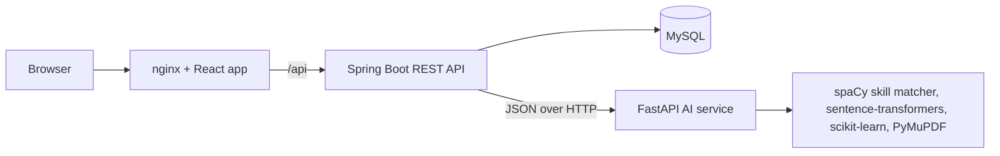
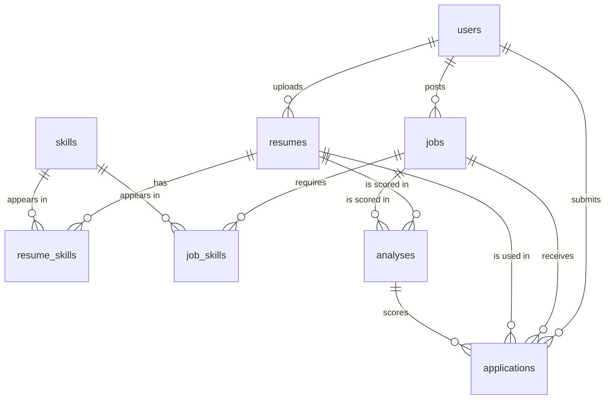

# AI Resume Analyzer & Job Matching System

A full-stack recruitment platform. Candidates upload a resume (PDF or DOCX) and the system extracts their skills, scores the resume against job postings with an **explainable hybrid score**, shows which skills are missing, and recommends the best-fitting jobs. Recruiters post jobs and see applicants **ranked by fit**, with the reasoning behind every score.

## Features

**Candidates**
- Register, log in, and upload resumes (PDF or DOCX, up to 5 MB)
- Automatic text extraction and skill detection
- Browse and search jobs, and check the match for any job: overall score, skill score, semantic score, experience/education fit, matched skills and missing skills
- Ranked job recommendations for any of their resumes
- Apply to jobs with a chosen resume

**Recruiters**
- Post jobs; the required skills are detected automatically from the description
- See their own jobs and the applicants for each, ranked by overall score
- Open any applicant to see matched skills, missing skills and a plain-English explanation

**Security**
- Passwords stored as BCrypt hashes
- Stateless JWT authentication with role-based access (candidate, recruiter)
- A candidate can only read their own resumes and analyses; a recruiter can only see applicants of their own jobs
- Upload validation (file type and size) and generated file names on disk

## Architecture



The **Spring Boot** backend owns users, authentication, resumes, jobs, applications and all business rules. The **FastAPI** service is a stateless AI worker: it extracts text from files, detects skills, and computes match scores. Only the nginx entry point is exposed in Docker; the backend, AI service and database stay on a private network.

**How a match is computed**

1. The resume is uploaded and stored; Spring Boot sends it to the AI service.
2. The AI service extracts the text (PyMuPDF / python-docx) and detects skills using a skills taxonomy with aliases (spaCy `PhraseMatcher`).
3. Spring Boot saves the text and skills. Job descriptions go through the same skill extraction when a job is posted.
4. For a match, Spring Boot sends the resume text, job description, both skill lists and the job's minimum experience to the AI service, which returns the component scores, matched and missing skills, and an explanation.
5. The result is stored and shown in the UI.

## Matching score

```
Overall = 0.50 x Skill match + 0.30 x Semantic similarity + 0.20 x Experience/education fit
```

| Component | Weight | How it is calculated |
|---|---|---|
| Skill match | 50% | Share of the job's required skills that appear in the resume |
| Semantic similarity | 30% | Sentence embeddings (`all-MiniLM-L6-v2`). The resume is split into ~120-word chunks; the average of the 3 chunks most similar to the job description is used, because the model has a limited input length |
| Experience/education fit | 20% | Heuristic: years of experience found in the resume versus the job's minimum, and the degree level found in the resume versus any degree the job asks for. Jobs with no requirement score 100% |

Example: skills 80%, semantic 55%, fit 100% gives 0.5 x 80 + 0.3 x 55 + 0.2 x 100 = **76.5%**.

A TF-IDF keyword similarity is also computed as a baseline for comparison, but it is not part of the overall score.

## Tech stack

| Layer | Technology |
|---|---|
| Frontend | React (Vite), React Router, Axios |
| Backend | Java 21, Spring Boot 4, Spring Security + JWT, Spring Data JPA / Hibernate |
| AI service | Python, FastAPI, spaCy, sentence-transformers, scikit-learn, PyMuPDF, python-docx |
| Database | MySQL |
| Testing | JUnit 5, Mockito, pytest |
| DevOps | Docker, Docker Compose, nginx, Git/GitHub |

## Run with Docker (recommended)

You only need [Docker Desktop](https://www.docker.com/products/docker-desktop/).

1. Copy `.env.example` to `.env` and set your own values:
   ```
   DB_PASSWORD=choose-a-password
   JWT_SECRET=a-long-random-string-of-at-least-32-characters
   ```
2. Build and start everything:
   ```
   docker compose up -d --build
   ```
   The first build takes 10 to 20 minutes (PyTorch, Maven dependencies and the language model are downloaded). Later builds are much faster.
3. Open **http://localhost:3000**, register a recruiter and a candidate, and try the full flow.

Useful commands:
```
docker compose ps            # container status
docker compose logs backend  # logs of one service
docker compose down          # stop; data is kept in volumes
docker compose down -v       # stop and delete the database and uploads
```

## Run locally without Docker

Requirements: Java 21, Maven, Python 3.12+, Node 20.19+, MySQL 8.

1. Create the database: `CREATE DATABASE resume_analyzer;`
2. **AI service**
   ```
   cd ai-service
   python -m venv venv
   venv\Scripts\activate          # Linux/macOS: source venv/bin/activate
   pip install -r requirements.docker.txt
   uvicorn main:app --reload --port 8000
   ```
3. **Backend**: set the environment variables `DB_PASSWORD` and `JWT_SECRET`, then
   ```
   cd backend
   ./mvnw spring-boot:run
   ```
4. **Frontend**
   ```
   cd frontend
   npm install
   npm run dev
   ```
   Open http://localhost:5173.

## API overview

**Spring Boot API** (JWT required except for `/api/auth/**` and `/api/health`)

| Method | Endpoint | Role | Purpose |
|---|---|---|---|
| POST | `/api/auth/register` | public | Create an account (candidate or recruiter) |
| POST | `/api/auth/login` | public | Log in and receive a JWT |
| POST | `/api/resumes/upload` | candidate | Upload and analyze a resume |
| GET | `/api/resumes/my` | candidate | List own resumes |
| GET | `/api/resumes/{id}` | candidate | Resume details with extracted skills |
| POST | `/api/jobs` | recruiter | Post a job (skills extracted automatically) |
| GET | `/api/jobs?keyword=` | any | Search jobs |
| GET | `/api/jobs/{id}` | any | Job details |
| GET | `/api/jobs/mine` | recruiter | Own jobs |
| POST | `/api/jobs/{id}/match` | candidate | Match a resume against a job |
| GET | `/api/analyses/{id}` | candidate | A stored match result |
| GET | `/api/jobs/recommended?resumeId=` | candidate | Jobs ranked for a resume |
| POST | `/api/jobs/{id}/apply` | candidate | Apply with a resume |
| GET | `/api/jobs/{id}/candidates` | recruiter | Ranked applicants for an own job |

**AI service** (internal): `POST /analyze-resume`, `POST /extract-skills`, `POST /match`, `POST /rank`, `GET /health`. Interactive docs are available at `/docs` when the service runs locally.

## Database



## Project structure

```
.
├── backend/           Spring Boot API (controllers, services, repositories, security)
├── ai-service/        FastAPI AI service (extraction, skills, matching, tests, evaluation)
├── frontend/          React app and nginx config
├── docker-compose.yml
└── .env.example
```

## Tests

```
cd ai-service && python -m pytest -v     # skill extraction, experience/education fit, scoring, semantic similarity
cd backend && ./mvnw test                # JWT utility and authentication service (JUnit, Mockito)
```

## Evaluation

`ai-service/evaluate.py` runs the real pipeline over a small labelled dataset (`ai-service/eval/dataset.json`: 5 resumes x 4 jobs, each pair labelled relevant or not) and compares four methods. **AUC** is the probability that a relevant pair scores higher than an irrelevant one. **Top-1** is how many resumes had a relevant job ranked first (ties that include an irrelevant job count as wrong).

<!-- TODO: run `python evaluate.py` in ai-service and paste your real numbers here -->

| Method | AUC | Top-1 (of 5) |
|---|---|---|
| Keyword only (TF-IDF) | TBD | TBD |
| Skills only | TBD | TBD |
| Semantic only | TBD | TBD |
| Hybrid (0.5 / 0.3 / 0.2) | TBD | TBD |

This is a small, hand-written dataset. It shows the pipeline behaves sensibly and illustrates the difference between keyword, skill-based and semantic matching. It does not measure accuracy on real-world data.

## Limitations and responsible use

- **Scores support human decisions; they do not make them.** Every result shows matched skills, missing skills and an explanation so a recruiter can check the reasoning.
- Skill detection only finds skills in the taxonomy (`ai-service/skills.json`). Unlisted skills are invisible, and extending the list is the main way to improve results.
- Experience and education fit is a pattern-matching heuristic and can miss unusual phrasing.
- Scanned (image-only) PDFs are rejected because there is no OCR.
- The semantic score uses the whole resume text. The system does not use protected attributes as explicit inputs, but embedding models can reflect biases in their training data, and a fairness evaluation on real data is future work.
- The evaluation dataset is small and synthetic.
- The JWT is kept in the browser's `localStorage`, which is acceptable for a learning project; a production system would use httpOnly cookies and refresh tokens.

## Roadmap

- OCR for scanned resumes
- Admin dashboard and skill taxonomy management
- "My applications" view and application status updates for recruiters
- Email notifications
- Evaluation on a larger set of real, anonymized resumes with human labels
- Resume improvement suggestions based on missing skills

## Author

**Jayesh Mohan Bagal**, Computer Science Engineering, DBATU
GitHub: [Jayesh7798](https://github.com/Jayesh7798) · LinkedIn: [jayesh-bagal](https://linkedin.com/in/jayesh-bagal)
